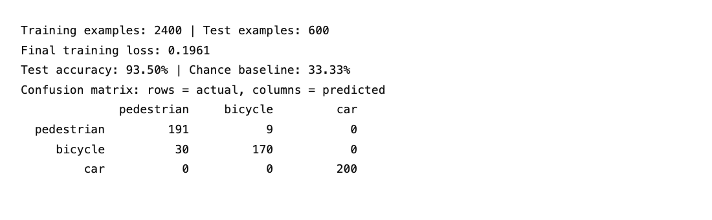

## Problem

This experiment uses multinomial logistic regression to classify a road
obstacle as a pedestrian, a bicycle with a rider, or a car. The inputs are
width, height, and speed. The model takes these measurements directly; it
does not identify objects in images.

The assignment calls for at least three classes, a dataset, and a logistic
regression classifier. Synthetic data makes it possible to study this model
without collecting road measurements. It also limits what the results can
show: this is a classification exercise, not a system for use on the road.

## Data

Each class has its own uniform ranges:

| Class | Width (m) | Height (m) | Speed (m/s) |
|:---|:---|:---|:---|
| Pedestrian | 0.3 to 0.9 | 1.2 to 2.0 | 0 to 3 |
| Bicycle with rider | 0.4 to 1.0 | 1.0 to 1.9 | 1 to 10 |
| Car | 1.4 to 2.2 | 1.2 to 2.0 | 0 to 25 |

These ranges are invented for the experiment, not estimates from observed
traffic. Within each range, equal-sized intervals have equal probability.
Each feature is sampled independently given the class, so choosing a width
does not affect the sampled height or speed.

For each feature, sampling uses

$$x = l + u(h-l), \qquad u \sim U(0,1),$$

where $l$ and $h$ are the lower and upper bounds for that class. A dictionary
keeps each class name next to its feature ranges. PyTorch tensors derived
from the dictionary let the script generate the examples in one batch.

The training set contains 800 examples per class, or 2,400 total. The test
set contains 200 per class, or 600 total. These are separate random draws
from the same distributions, and each set is shuffled. Seed 448 fixes data
generation and model initialization. Because the classes are balanced,
uniform random guessing has an expected accuracy of 33.33%.

Before training, each feature is centered and divided by its training
standard deviation. The test set uses the same training means and standard
deviations. Test statistics therefore do not affect preprocessing.

## Classifier and training

The model is a single PyTorch `nn.Linear(3, 3)` layer. It has nine weights
and three biases, with no hidden layers. For a standardized input vector
$x$, it computes three scores:

$$z = Wx + b, \qquad P(y=k \mid x) = \frac{e^{z_k}}{\sum_{j=1}^{3} e^{z_j}}.$$

Training minimizes mean cross-entropy, the negative log probability assigned
to the correct class. PyTorch's `CrossEntropyLoss` takes the raw scores and
applies log-softmax internally. Applying softmax before this loss would be
unnecessary and would give it the wrong form of input.

Adam updates the model for 500 full-batch steps at a learning rate of 0.05.
Each step clears the previous gradients, computes the loss, backpropagates,
and updates the parameters. At evaluation time, the predicted class is the
one with the largest score. Computing softmax is unnecessary for this choice
because it preserves the score ordering. The test data does not participate
in optimization.

## Performance

The CPU run reached a final training loss of 0.1961 and classified 561 of
600 test examples correctly, for 93.50% accuracy. Figure 1 shows the output
from that run.

{width=100%}

The confusion matrix gives more detail than overall accuracy. Of the 200
pedestrians, 191 were correct and nine were classified as bicycles. Of the
200 bicycles, 170 were correct and 30 were classified as pedestrians. All
200 cars were correct. Recall was therefore 95.5% for pedestrians, 85.0% for
bicycles, and 100% for cars.

All 39 mistakes were between pedestrians and bicycles. Their feature ranges
overlap, so some measurements are consistent with either class. Cars are
much easier in this dataset because their width range does not overlap
with either of the other classes. The perfect car score reflects that
choice of data ranges; it does not establish reliable car recognition in
real traffic.

## Implementation challenges and decisions

Readability needed attention during implementation. The first version kept
class names, lower bounds, and upper bounds in separate lists. A dictionary
now puts each class's information in one place. The sampling expression was
also split into a named random offset and an addition to the lower bound.
These changes made the data generation easier to read without changing the
reported results.

The features use different units and numerical ranges. Speed reaches 25,
while width and height stay near one or two. Training-only standardization
puts them on comparable scales without using information from the test set.

The run also produced a PyTorch warning about unavailable NumPy integration.
The script uses PyTorch tensors throughout and completed without NumPy, so
no extra dependency was added for that unused integration.

Overlap remains a limitation rather than a bug to remove. The model has
linear decision boundaries, and the class-specific uniform distributions
can produce boundaries it cannot represent exactly. Where class
distributions overlap, even noiseless measurements may not determine a
unique label.

## Lessons and limits

This experiment shows how a single linear layer and cross-entropy implement
multiclass logistic regression. It also shows why the confusion matrix
matters: a 93.50% aggregate score hides lower recall for bicycles and an
especially easy car class.

The data assumptions matter as much as the classifier here. Real obstacle
measurements need not be uniform or independent, and real sensors introduce
errors that this experiment omits. The balanced test set measures performance
on the same synthetic distributions used for training, not on real road
data. A fixed seed makes the run repeatable, though results may vary slightly
across PyTorch versions and platforms.

## Reproduce the run

From the repository root:

```sh
uv run cmpsc-448/hw1/main.py
```

The script declares its Python and PyTorch requirements inline. `uv` installs
them in an isolated cache; the run does not require a GPU or a dataset download.
