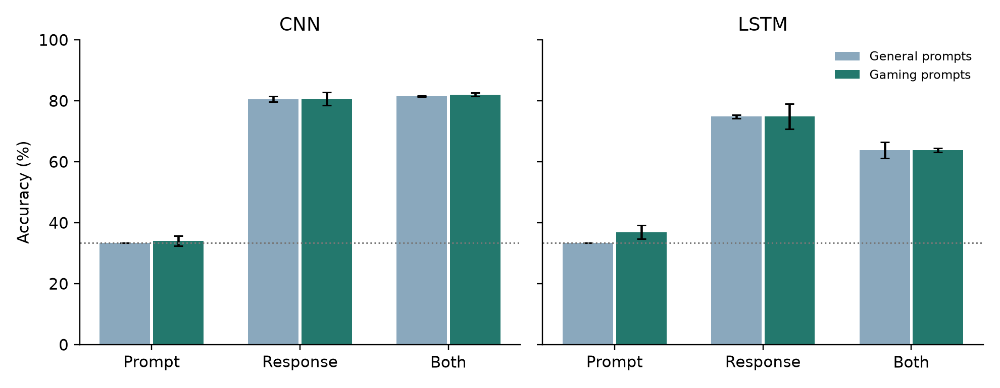

# Who wrote the walkthrough?

**Adam Torres | CMPSC 448 | Individual midterm project**

Can classifiers trained on general prompts recognize which LLM wrote a gaming response? This project compares a CNN and bidirectional LSTM on GPT-4, Llama 2 70B Chat, and Falcon 40B Instruct responses from UltraFeedback. Gaming examples include game design, strategy, development, and gaming hardware. The title is thematic; the dataset is broader than literal walkthroughs.

[Read the report](report.pdf)

## Reproduce

Requirements: Python 3.12, [uv](https://docs.astral.sh/uv/), and `curl`. Run from this directory:

```sh
uv sync --frozen
uv run python -m pytest tests -q
uv run python -m fingerprint.data
uv run python -m fingerprint.train
uv run python -m fingerprint.analyze
uv run python build_report.py
```

Data preparation downloads approximately 350 MB from a pinned Hugging Face revision and verifies both SHA-256 checksums. Training runs on CPU with four threads. The experiment grid contains 24 runs: two architectures, four input conditions, and seeds 11, 29, and 47. Each run trains for at most 12 epochs with validation-based early stopping. No paid APIs or model keys are needed.

Raw data and model checkpoints are local, ignored files. The committed manifest contains source row numbers, prompt hashes, labels, and split assignments. All test predictions and training histories are retained in `results/`. Re-running the full grid overwrites its corresponding result files. The analysis command rejects an incomplete grid.

`report-source.json` contains the edited prose. `build_report.py` renders it together with the recorded metrics into `report.pdf`.

## Experimental controls

- Training: 800 responses per class. Validation: 150 per class.
- General test: 132 prompts answered by all three models, giving 396 responses. Prompt-only accuracy is exactly one third by construction.
- Gaming test: 31 responses per class across 78 distinct prompts. The same prompt can have multiple model responses; confidence intervals resample whole prompts.
- Split assignment precedes balancing. A normalized prompt hash cannot appear in two splits. The vocabulary uses training text only.
- `game-review.json` freezes manually reviewed, zero-based source row indices. A broad keyword search supplied candidates. Review included game rules, strategy, game development, gaming hardware and industry; it excluded sports, figurative uses, unrelated puzzles dressed up as games, and ambiguous references. Every broad keyword candidate is excluded from the general pool, including rejected candidates. Keyword recall is imperfect.
- The prompt-only, response-only, and combined conditions address RQ1 and RQ2. Holding games out of fitting addresses RQ3. Common Markdown removal and simple style baselines address RQ4.
- Explicit names on a fixed model/vendor list are replaced with a shared token. This reduces trivial self-identification but cannot guarantee removal of every indirect clue.
- Normalization removes common Markdown markers and whitespace structure from the same response prefix used by the raw model. It is evaluated both as a test-time edit and with retraining. It is a partial formatting intervention, not a guarantee of unchanged semantics.

## Results at a glance



The PDF reports the study and its limitations. The plot shows mean accuracy and standard deviation across three seeds; complete predictions and prompt-bootstrap intervals are in `results/summary.json`.

## Implementation

`fingerprint/data.py` owns selection and encoding. `models.py` contains the CNN and LSTM. `train.py` fits each condition and saves predictions. `analyze.py` aggregates results, bootstraps uncertainty, and fits inexpensive length/style baselines.

The 10,000-entry training vocabulary preserves case, punctuation, and newlines. Both models learn 64-dimensional embeddings from scratch. The CNN uses 64 filters at each of widths 3, 5, and 7, ReLU, and masked max pooling. The LSTM has one bidirectional layer with 64 hidden units per direction. Both use dropout 0.3, cross-entropy, AdamW (learning rate 0.001, weight decay 0.01), batch size 64, and gradient clipping at 1.0. Validation macro-F1 selects the checkpoint; patience is three epochs.

The prompt budget is 96 tokens and the response budget is 160. Combined inputs concatenate the prompt, a separator, and response, so they have a larger total budget. Padding does not affect pooled representations. General and gaming tests never select hyperparameters or checkpoints.

## Scope and sources

The source is [UltraFeedback](https://huggingface.co/datasets/openbmb/UltraFeedback), revision `40b436560ca83a8dba36114c22ab3c66e43f6d5e`. Only its Evol-Instruct and UltraChat subsets are used. The dataset card labels the dataset MIT; its source material has its own provenance. This repository distributes identifiers and derived statistics rather than raw conversations. Neither GPT-4 feedback scores nor critiques are classifier features.

This is a small, closed-set study of recorded model configurations. It is not a human-versus-AI detector, a detector of current model releases, or a reliable way to identify an arbitrary text's author. UltraFeedback varies system instructions, and the gaming holdout is small and not fully prompt-matched. Those limits matter when interpreting domain differences.

Sources:

1. Cui et al. *UltraFeedback: Boosting Language Models with Scaled AI Feedback*. https://arxiv.org/abs/2310.01377
2. McGovern et al. *Your Large Language Models Are Leaving Fingerprints*. 2024. https://arxiv.org/abs/2405.14057
3. Kim. *Convolutional Neural Networks for Sentence Classification*. 2014. https://arxiv.org/abs/1408.5882
4. PyTorch documentation: [LSTM](https://docs.pytorch.org/docs/stable/generated/torch.nn.LSTM.html), [Conv1d](https://docs.pytorch.org/docs/stable/generated/torch.nn.Conv1d.html).

## Assistance and submission

Codex assisted with project design, implementation, experiments, analysis, and drafting. WriteHuman was used to edit report prose; its output was checked against the recorded experiment results. Dataset responses were never humanized or rewritten beyond the documented masking and ablation. Detector scores are not evidence of authorship or scientific validity.

The assignment requires a GitHub repository URL containing code and the PDF report. Review the report and code before submitting that URL in Canvas. No presentation is included.
